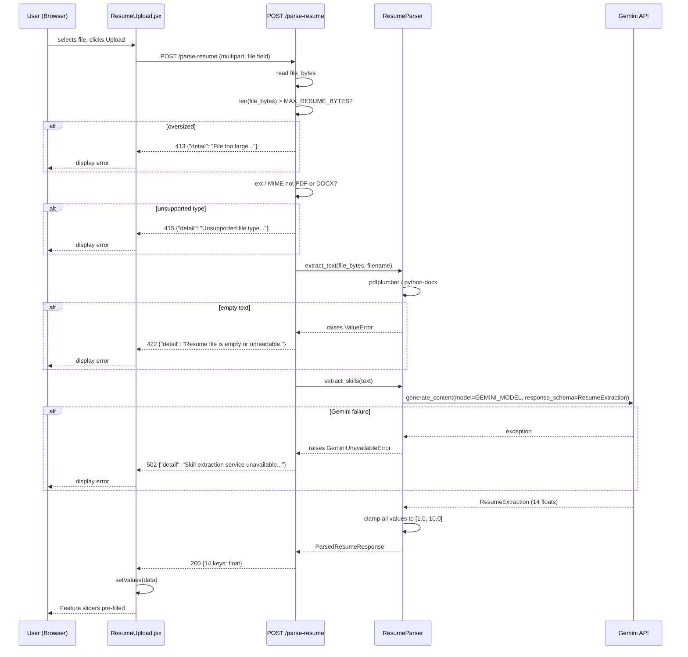

# Design Document — Resume Upload & Skill Extraction (Phase 2)

## Overview

Phase 2 adds resume-based skill extraction to the existing Career Prediction Platform.
A user uploads a PDF or DOCX resume; the backend extracts raw text, calls the Gemini API
with a structured response schema, clamps all values to [1.0, 10.0], and returns 14 floats
that map directly to the `orderedKeys` array in `page.js`. The frontend `ResumeUpload`
component pre-fills the `values` state so the user can review and adjust every score before
clicking Predict.

**Phase 2 is purely additive.** No Phase 1 file is modified. The only allowed mutations are:
- Two lines appended to `app/config/constants.py`
- Two lines added to `app/main.py` (router import + `include_router`)
- The lifespan function in `main.py` gains one `ResumeParser` instantiation line

---

## Architecture

```
┌──────────────────────────────────────────────────────────────┐
│  Next.js  (my-app)                                           │
│  ResumeUpload.jsx  ──POST /parse-resume (multipart)──►       │
└──────────────────────────────────────────────────────────────┘
                              │
                              ▼
┌──────────────────────────────────────────────────────────────┐
│  FastAPI  (app/routes/resume.py)                             │
│  1. Size check  (> MAX_RESUME_BYTES → 413)                   │
│  2. Extension / MIME check  (not PDF/DOCX → 415)             │
│  3. Delegates to request.app.state.resume_parser             │
└──────────────────────────────────────────────────────────────┘
                              │
                              ▼
┌──────────────────────────────────────────────────────────────┐
│  ResumeParser  (app/services/resume_parser.py)               │
│  extract_text()  →  pdfplumber / python-docx                 │
│  extract_skills() →  google-genai  (structured output)       │
│  server-side clamp  →  max(1.0, min(10.0, v))               │
└──────────────────────────────────────────────────────────────┘
                              │
                              ▼
                    Gemini API  (gemini-2.5-flash-lite)
```

Phase 1 components (`predictor`, `feature_mapper`, `model_registry`) are entirely
independent and untouched.


## Components and Interfaces

### 1. New File List

| Path | Purpose |
|------|---------|
| `backend/fastapi/app/schemas/resume.py` | `ResumeExtraction` (Gemini schema) and `ParsedResumeResponse` (route response) Pydantic models |
| `backend/fastapi/app/services/resume_parser.py` | `ResumeParser` class — text extraction and Gemini API call |
| `backend/fastapi/app/routes/resume.py` | `POST /parse-resume` route handler |
| `backend/fastapi/tests/test_resume_route.py` | Phase 2 test suite (pytest, mocked Gemini) |
| `backend/fastapi/tests/test_phase1_regression.py` | Regression wrapper that re-runs Phase 1 tests |
| `my-app/app/components/ResumeUpload.jsx` | Frontend file-upload component |

### 2. `app/config/constants.py` — Additive Append Only

Two constants are **appended** to the existing file. No existing line is touched.

```python
# --- Phase 2 additions (append after ROLE_MAPPING) ---
GEMINI_MODEL: str = "gemini-2.5-flash-lite"
MAX_RESUME_BYTES: int = 5 * 1024 * 1024   # 5 MB
```

`GEMINI_MODEL` is `"gemini-2.5-flash-lite"` — the stable (non-preview) free-tier Flash model
as of July 2025, designed for simple data extraction with structured output support and the
highest free-tier rate limits (15 RPM, 1 000 req/day).

### 3. Custom Exceptions

Defined at module level in `app/services/resume_parser.py` (before the class) so they can be
imported by the route without a circular dependency:

```python
class UnsupportedMediaTypeError(Exception):
    """Raised when a file format other than PDF or DOCX is supplied."""

class GeminiUnavailableError(Exception):
    """Raised when the Gemini API call fails or times out."""
```


## Data Models

### `app/schemas/resume.py`

#### Key mapping note

`page.js` uses `conscientiousness` (correct spelling) as a key in `orderedKeys`.
`Features.jsx` has a typo (`conscientousness`) in its display key — that typo is a **Phase 1
artefact that must not be changed**. The backend must match `page.js`'s `orderedKeys` exactly.

The 14 `orderedKeys` (in order):

```
computer_architecture, programming_skills, project_management, communication_skills,
openness, conscientiousness, extraversion, agreeableness, emotional_range, conversation,
openness_change, hedonism, self_enhancement, self_transcendence
```

#### `ResumeExtraction` — Gemini structured-output schema

One field per feature name in the same order as `orderedKeys`. All field **names** are the
snake_case orderedKey strings. The field names are **not** derived dynamically from
`constants.py` at class-definition time (Pydantic requires static field names); instead the
field order mirrors `TECHNICAL_FEATURES + PERSONALITY_FEATURES` and is documented with a
comment cross-referencing the constants.

```python
from pydantic import BaseModel, Field

class ResumeExtraction(BaseModel):
    # Field order mirrors TECHNICAL_FEATURES + PERSONALITY_FEATURES from constants.py
    computer_architecture:  float = Field(ge=1.0, le=10.0)
    programming_skills:     float = Field(ge=1.0, le=10.0)
    project_management:     float = Field(ge=1.0, le=10.0)
    communication_skills:   float = Field(ge=1.0, le=10.0)
    openness:               float = Field(ge=1.0, le=10.0)
    conscientiousness:      float = Field(ge=1.0, le=10.0)
    extraversion:           float = Field(ge=1.0, le=10.0)
    agreeableness:          float = Field(ge=1.0, le=10.0)
    emotional_range:        float = Field(ge=1.0, le=10.0)
    conversation:           float = Field(ge=1.0, le=10.0)
    openness_change:        float = Field(ge=1.0, le=10.0)
    hedonism:               float = Field(ge=1.0, le=10.0)
    self_enhancement:       float = Field(ge=1.0, le=10.0)
    self_transcendence:     float = Field(ge=1.0, le=10.0)
```


#### `ParsedResumeResponse` — Route response model

Keyed to the 14 `orderedKeys` used by the frontend. All values are floats clamped to
[1.0, 10.0] before the response is built.

```python
class ParsedResumeResponse(BaseModel):
    computer_architecture:  float
    programming_skills:     float
    project_management:     float
    communication_skills:   float
    openness:               float
    conscientiousness:      float
    extraversion:           float
    agreeableness:          float
    emotional_range:        float
    conversation:           float
    openness_change:        float
    hedonism:               float
    self_enhancement:       float
    self_transcendence:     float
```

`ParsedResumeResponse` is intentionally **not** `ResumeExtraction` — the schema model carries
Pydantic `Field` constraints for Gemini, while the response model is a plain typed model with
no constraints (the clamp is the authoritative guard).

---

## `app/services/resume_parser.py` — `ResumeParser` Design

### `__init__(self)`

```python
def __init__(self) -> None:
    load_dotenv()
    api_key = os.environ.get("GEMINI_API_KEY", "").strip()
    if not api_key:
        raise RuntimeError("GEMINI_API_KEY is not set")
    self._client = google.genai.Client(api_key=api_key)
```

- Calls `load_dotenv()` so the key is sourced from `backend/fastapi/.env`.
- Raises `RuntimeError("GEMINI_API_KEY is not set")` immediately if absent or empty — no
  lazy evaluation, so misconfiguration is caught at app startup (lifespan).
- `GEMINI_API_KEY` value is never logged or included in any exception message.

### `extract_text(self, file_bytes: bytes, filename: str) -> str`

```python
def extract_text(self, file_bytes: bytes, filename: str) -> str:
    ext = filename.rsplit(".", 1)[-1].lower() if "." in filename else ""
    if ext == "pdf":
        text = self._extract_pdf(file_bytes)
    elif ext == "docx":
        text = self._extract_docx(file_bytes)
    else:
        raise UnsupportedMediaTypeError(
            f"Unsupported file type: .{ext}. Only PDF and DOCX are accepted."
        )
    if not text or not text.strip():
        raise ValueError("Resume file is empty or unreadable")
    return text
```

- `_extract_pdf` wraps `pdfplumber.open(io.BytesIO(file_bytes))` and concatenates all page
  text with newlines.
- `_extract_docx` wraps `docx.Document(io.BytesIO(file_bytes))` and joins all paragraph text.
- Both helpers return raw `str`; emptiness check is centralised in `extract_text`.


### `extract_skills(self, text: str) -> ParsedResumeResponse`

```python
def extract_skills(self, text: str) -> ParsedResumeResponse:
    prompt = (
        "You are a career assessment assistant. "
        "Analyse the following resume text and score the candidate on each skill "
        "from 1.0 (lowest) to 10.0 (highest). "
        "Return only the structured scores.\n\nResume:\n" + text
    )
    try:
        # NOTE: Free-tier Gemini requests may be used by Google for model training
        # and improvement. Do not send confidential, proprietary, or personally
        # identifiable information through this path without first reviewing
        # Google's data usage policies and upgrading to a paid tier if required.
        response = self._client.models.generate_content(
            model=GEMINI_MODEL,
            contents=prompt,
            config=types.GenerateContentConfig(
                response_mime_type="application/json",
                response_schema=ResumeExtraction,
            ),
        )
    except Exception as exc:
        raise GeminiUnavailableError(
            f"Gemini API call failed: {exc}"
        ) from exc

    extraction: ResumeExtraction = response.parsed
    # Server-side clamp — authoritative enforcement regardless of schema validation
    clamped = {
        field: max(1.0, min(10.0, getattr(extraction, field)))
        for field in extraction.model_fields
    }
    return ParsedResumeResponse(**clamped)
```

Key design decisions:
- `response.parsed` returns a `ResumeExtraction` instance directly from the SDK — no manual
  JSON parsing.
- The clamp iterates `extraction.model_fields` (all 14 field names) so no feature name string
  appears in `resume_parser.py`.
- `GEMINI_MODEL` is imported from `app.config.constants` — the literal `"gemini-2.5-flash-lite"`
  never appears in this file.

---

## `app/routes/resume.py` — Route Design

```python
from fastapi import APIRouter, Request, UploadFile, File
from fastapi.responses import JSONResponse

from app.config.constants import MAX_RESUME_BYTES
from app.schemas.resume import ParsedResumeResponse
from app.services.resume_parser import GeminiUnavailableError, UnsupportedMediaTypeError

resume_router = APIRouter()

ALLOWED_EXTENSIONS = {"pdf", "docx"}
ALLOWED_MIMES = {
    "application/pdf",
    "application/vnd.openxmlformats-officedocument.wordprocessingml.document",
}

@resume_router.post("/parse-resume", response_model=ParsedResumeResponse)
async def parse_resume(request: Request, file: UploadFile = File(...)):
    # 1. Size guard (read once, check length)
    file_bytes = await file.read()
    if len(file_bytes) > MAX_RESUME_BYTES:
        return JSONResponse(
            status_code=413,
            content={"detail": "File too large. Maximum allowed size is 5 MB."},
        )

    # 2. Extension / MIME guard
    filename = file.filename or ""
    ext = filename.rsplit(".", 1)[-1].lower() if "." in filename else ""
    if ext not in ALLOWED_EXTENSIONS or file.content_type not in ALLOWED_MIMES:
        return JSONResponse(
            status_code=415,
            content={"detail": "Unsupported file type. Upload a PDF or DOCX file."},
        )

    parser = request.app.state.resume_parser

    # 3. Text extraction
    try:
        text = parser.extract_text(file_bytes, filename)
    except UnsupportedMediaTypeError:
        return JSONResponse(
            status_code=415,
            content={"detail": "Unsupported file type. Upload a PDF or DOCX file."},
        )
    except ValueError:
        return JSONResponse(
            status_code=422,
            content={"detail": "Resume file is empty or unreadable."},
        )

    # 4. Skill extraction
    try:
        result = parser.extract_skills(text)
    except GeminiUnavailableError:
        return JSONResponse(
            status_code=502,
            content={"detail": "Skill extraction service unavailable. Please try again later."},
        )

    return result
```

The extension check and the MIME check are **both** applied (belt-and-suspenders) before any
bytes are passed to `ResumeParser`.


---

## `app/main.py` Delta

Exactly three additions. All other lines remain byte-for-byte identical to Phase 1.

### New imports (added after existing route import)

```python
from app.routes.resume import resume_router
from app.services.resume_parser import ResumeParser
```

### Lifespan change — one new line inside the startup block

```python
@asynccontextmanager
async def lifespan(app: FastAPI):
    # Startup: load models and register MLflow baseline
    app.state.feature_mapper = FeatureMapper()
    app.state.predictor = PredictorService()
    app.state.resume_parser = ResumeParser()          # ← Phase 2 addition
    ModelRegistry().register_baseline_if_needed()
    yield
    # Shutdown: nothing to clean up
```

`ResumeParser.__init__` raises `RuntimeError` if `GEMINI_API_KEY` is missing, so the
application refuses to start on misconfiguration — caught before the first request.

### Router registration (added after existing `app.include_router(router)`)

```python
app.include_router(resume_router)
```

---

## Frontend — `my-app/app/components/ResumeUpload.jsx`

```jsx
'use client'
import { useState } from 'react'

const ACCEPTED = 'application/pdf,application/vnd.openxmlformats-officedocument.wordprocessingml.document'

export default function ResumeUpload({ setValues }) {
  const [loading, setLoading] = useState(false)
  const [error, setError] = useState('')

  async function handleSubmit(e) {
    e.preventDefault()
    const file = e.target.elements.resume.files[0]
    if (!file) return

    setLoading(true)
    setError('')

    const formData = new FormData()
    formData.append('file', file)

    try {
      const res = await fetch('http://127.0.0.1:8000/parse-resume', {
        method: 'POST',
        body: formData,
      })
      const data = await res.json()
      if (!res.ok) {
        setError(data.detail || 'Upload failed. Please try again.')
        return
      }
      setValues(data)           // pre-fills all 14 keys in page.js values state
    } catch {
      setError('Network error. Please check your connection.')
    } finally {
      setLoading(false)
    }
  }

  return (
    <div className="text-center my-8 px-4">
      <h2 className="text-2xl font-bold mb-3">Auto-fill from Resume</h2>
      <p className="text-gray-500 mb-4 text-sm">
        Upload a PDF or DOCX resume to pre-fill the feature scores below.
      </p>
      <form onSubmit={handleSubmit} className="flex flex-col items-center gap-3">
        <input
          name="resume"
          type="file"
          accept={ACCEPTED}
          disabled={loading}
          className="border rounded-lg p-2 text-sm"
        />
        <button
          type="submit"
          disabled={loading}
          className="px-5 py-2 bg-indigo-600 text-white rounded-lg disabled:opacity-50"
        >
          {loading ? 'Extracting…' : 'Upload & Extract Skills'}
        </button>
      </form>
      {error && <p className="mt-3 text-red-500 text-sm">{error}</p>}
    </div>
  )
}
```

- `setValues` is passed down from `page.js`; on success the full 14-key object from the
  backend replaces the current `values` state.
- Loading state disables both the input and the button, preventing duplicate submissions.
- Error messages are displayed inline; on error the `values` state is not touched.


## `page.js` Delta

Two additions only. All other lines remain identical.

### New import (added after existing `Features` import)

```js
import ResumeUpload from "./components/ResumeUpload";
```

### JSX change — `ResumeUpload` rendered above `Features`

```jsx
return (
  <div>
    <ResumeUpload setValues={setValues} />   {/* ← Phase 2 addition */}
    <Features values={values} setValues={setValues} />
    ...
  </div>
)
```

`setValues` is already present in `page.js`; no new state is introduced.

---

## Sequence Diagram — POST /parse-resume End-to-End




---

## Error Handling Table

| Scenario | Where caught | HTTP status | Response body |
|---|---|---|---|
| File size > 5 MB | Route (before extraction) | 413 | `{"detail": "File too large. Maximum allowed size is 5 MB."}` |
| Unsupported MIME / extension | Route (before extraction) | 415 | `{"detail": "Unsupported file type. Upload a PDF or DOCX file."}` |
| `UnsupportedMediaTypeError` from parser | Route (`except UnsupportedMediaTypeError`) | 415 | `{"detail": "Unsupported file type. Upload a PDF or DOCX file."}` |
| Empty / whitespace-only text | Route (`except ValueError`) | 422 | `{"detail": "Resume file is empty or unreadable."}` |
| Gemini API error / timeout | Route (`except GeminiUnavailableError`) | 502 | `{"detail": "Skill extraction service unavailable. Please try again later."}` |
| Missing `GEMINI_API_KEY` | `ResumeParser.__init__` at startup | App refuses to start — `RuntimeError` | N/A (startup failure, not HTTP) |
| Unexpected exception | FastAPI global handler (Phase 1) | 500 | `{"detail": "Internal prediction error"}` |

The global exception handler from Phase 1 (`main.py`) acts as the final safety net for any
path not explicitly caught by the resume route.

---

## Correctness Properties

*A property is a characteristic or behavior that should hold true across all valid executions
of a system — essentially, a formal statement about what the system should do. Properties serve
as the bridge between human-readable specifications and machine-verifiable correctness guarantees.*

### Property Reflection

After prework analysis, the following consolidations were made:

- **Req 4.2 (200 + 14 keys) and Req 2.3 (exactly 14 floats) describe the same observable
  result** — merged into Property 1.
- **Req 4.3 (HTTP 415) and Req 1.4 (UnsupportedMediaTypeError)** are two layers of the same
  invariant — merged into Property 2.
- **Req 2.8 (clamp) and Req 12 (clamp test)** are identical — single Property 3.
- **Req 2.5 (GeminiUnavailableError) and Req 4.6 (HTTP 502)** are service vs route views of
  the same failure — merged into Property 4.
- **Req 1.3 (ValueError for empty text) and Req 4.5 (HTTP 422)** are merged into Property 5.


### Property 1: Valid resume upload always returns exactly 14 clamped floats

*For any* valid PDF or DOCX file whose text is non-empty, the `POST /parse-resume` endpoint
SHALL return HTTP 200 with a JSON object containing exactly the 14 keys from `orderedKeys`
(`computer_architecture`, `programming_skills`, `project_management`, `communication_skills`,
`openness`, `conscientiousness`, `extraversion`, `agreeableness`, `emotional_range`,
`conversation`, `openness_change`, `hedonism`, `self_enhancement`, `self_transcendence`),
each mapped to a `float` in `[1.0, 10.0]`.

**Validates: Requirements 2.3, 4.2**

### Property 2: Unsupported file type always yields 415

*For any* file whose extension is not `.pdf` or `.docx` (or whose MIME type does not match),
uploading it to `POST /parse-resume` SHALL always yield HTTP 415, regardless of file size or
content.

**Validates: Requirements 1.4, 4.3**

### Property 3: Server-side clamp is the authoritative enforcement layer

*For any* Gemini response containing at least one value below 1.0 or above 10.0,
the `POST /parse-resume` endpoint SHALL return HTTP 200 with all values clamped such that
`1.0 ≤ value ≤ 10.0`. The clamp `max(1.0, min(10.0, v))` is applied after the SDK call,
independent of Pydantic schema validation.

**Validates: Requirements 2.8, 12.1, 12.2, 12.3**

### Property 4: Gemini failure always returns 502 and leaves the app alive

*For any* exception raised by the Gemini SDK (network error, quota exceeded, malformed
response, etc.), the `POST /parse-resume` endpoint SHALL return HTTP 502 and the FastAPI
application SHALL remain running and available to handle subsequent requests.

**Validates: Requirements 2.5, 4.6, 9.4**

### Property 5: Empty or whitespace-only resume text always returns 422

*For any* uploaded file whose extracted text is empty or composed entirely of whitespace
characters, the `POST /parse-resume` endpoint SHALL return HTTP 422 with the detail message
`"Resume file is empty or unreadable."` and SHALL NOT call the Gemini API.

**Validates: Requirements 1.3, 4.5**

---


## Testing Strategy

### Framework and Environment

- **pytest only** — no Hypothesis, no other property-based library.
- All tests run inside `backend/fastapi/venv`.
- No test makes a real network call to the Gemini API; the `google.genai.Client` is mocked.

### `backend/fastapi/tests/test_resume_route.py`

#### Fixtures (in `conftest.py` or module-level `@pytest.fixture`)

> These fixtures are added to a new section in `conftest.py` or defined in
> `test_resume_route.py` itself. They do **not** modify any existing fixture.

| Fixture | Scope | Description |
|---|---|---|
| `minimal_pdf_bytes` | `session` | A minimal valid PDF (created with `pdfplumber`-compatible bytes or a tiny hardcoded PDF). Build via `reportlab` or use a 500-byte hand-crafted PDF with the text `"Python developer with 3 years experience."` |
| `minimal_docx_bytes` | `session` | A minimal valid DOCX created with `python-docx` in memory (`io.BytesIO`), containing at least one paragraph with real text. |
| `oversized_bytes` | `session` | `b"x" * (5 * 1024 * 1024 + 1)` — 5 MB + 1 byte, named with `.pdf` extension when uploaded. |
| `mock_gemini_response` | `function` | A `ResumeExtraction` instance with all 14 fields set to `5.0`. Used as the return value of `response.parsed` on the mocked SDK. |
| `mock_gemini_client` | `function` | `pytest.monkeypatch` / `unittest.mock.patch` targeting `app.services.resume_parser.google.genai.Client`. Configured to return `mock_gemini_response` via `client.models.generate_content().parsed`. |
| `resume_client` | `module` | A `TestClient(app)` with the `mock_gemini_client` applied at startup so `app.state.resume_parser` holds a `ResumeParser` backed by the mock. |

#### Test Cases

```
test_valid_pdf_returns_200_with_14_keys
  - Upload minimal_pdf_bytes as "resume.pdf" with content_type="application/pdf"
  - Mock Gemini returns all 5.0
  - Assert response.status_code == 200
  - Assert set(body.keys()) == set(ORDERED_KEYS)  # ORDERED_KEYS defined as constant in test file
  - Assert all(isinstance(v, float) for v in body.values())
  - Assert all(1.0 <= v <= 10.0 for v in body.values())

test_valid_docx_returns_200_with_14_keys
  - Upload minimal_docx_bytes as "resume.docx"
    with content_type="application/vnd.openxmlformats-officedocument.wordprocessingml.document"
  - Same assertions as PDF test

test_unsupported_type_returns_415
  - Upload b"hello" as "resume.txt" with content_type="text/plain"
  - Assert response.status_code == 415
  - Assert body["detail"] == "Unsupported file type. Upload a PDF or DOCX file."

test_oversized_file_returns_413
  - Upload oversized_bytes as "big.pdf" with content_type="application/pdf"
  - Assert response.status_code == 413
  - Assert body["detail"] == "File too large. Maximum allowed size is 5 MB."

test_empty_file_returns_422
  - Upload b"" (zero bytes) as "empty.pdf" with content_type="application/pdf"
  - Mock pdfplumber to return "" or patch extract_text to raise ValueError
  - Assert response.status_code == 422
  - Assert body["detail"] == "Resume file is empty or unreadable."

test_gemini_error_returns_502_and_app_stays_alive
  - Configure mock Gemini to raise Exception("quota exceeded")
  - Upload minimal_pdf_bytes as "resume.pdf"
  - Assert response.status_code == 502
  - Assert body["detail"] == "Skill extraction service unavailable. Please try again later."
  - Send a second request (GET /) and assert 200 — app is still alive

test_out_of_range_clamp_returns_clamped_values
  - Configure mock Gemini response.parsed to return a ResumeExtraction where:
      computer_architecture = 0.0   (below minimum → should clamp to 1.0)
      programming_skills    = 15.0  (above maximum → should clamp to 10.0)
      all other fields      = 5.0
  - Upload minimal_pdf_bytes as "resume.pdf"
  - Assert response.status_code == 200
  - Assert body["computer_architecture"] == 1.0
  - Assert body["programming_skills"] == 10.0
  - Assert all(1.0 <= v <= 10.0 for v in body.values())
```

#### `ORDERED_KEYS` constant (test-local)

```python
ORDERED_KEYS = [
    "computer_architecture", "programming_skills", "project_management",
    "communication_skills", "openness", "conscientiousness", "extraversion",
    "agreeableness", "emotional_range", "conversation", "openness_change",
    "hedonism", "self_enhancement", "self_transcendence",
]
```


### `backend/fastapi/tests/test_phase1_regression.py`

#### Approach

`test_phase1_regression.py` directly imports and re-executes every test function from the
three Phase 1 test modules. This means pytest collects them as normal test items and they
appear in the report individually — no subprocess, no `--co` trick.

```python
# test_phase1_regression.py
"""
Regression wrapper: re-runs all Phase 1 test functions.
No fixture redefinition — conftest.py fixtures are reused automatically.
"""

# Re-export all test functions so pytest collects them from this file
from tests.test_predict_route import (
    test_predict_valid_input_returns_200,
    test_predict_wrong_length_returns_422,
    test_health_check,
)
from tests.test_feature_mapper import (
    test_feature_mapper_smoke,
    test_feature_mapper_output_shape,
    test_feature_mapper_rejects_too_few_values,
    test_feature_mapper_rejects_too_many_values,
)
from tests.test_predictor_service import (
    test_predictor_service_smoke,
    test_predicted_role_is_valid,
    test_top_3_roles_count,
    test_top_3_roles_probabilities_in_range,
    test_predictor_service_bad_models_dir,
)
```

- Fixtures from `conftest.py` (`models_dir`, `sample_rows`, `feature_mapper`,
  `predictor_service`) are resolved automatically by pytest — no duplication.
- The module-scoped `client` fixture in `test_predict_route.py` is defined at module level;
  when the function is re-imported here it will use the same fixture resolution path.
- Running `pytest tests/test_phase1_regression.py -v` inside `backend/fastapi/venv` must
  report **zero failures**.

### Mocking Strategy for Gemini

The Gemini client is patched at the `google.genai.Client` symbol as imported inside
`app.services.resume_parser`. The recommended pattern uses `pytest`'s `monkeypatch` or
`unittest.mock.patch` as a context manager:

```python
@pytest.fixture
def mock_gemini(monkeypatch):
    mock_client = MagicMock()
    mock_response = MagicMock()
    mock_response.parsed = ResumeExtraction(
        computer_architecture=5.0, programming_skills=5.0, project_management=5.0,
        communication_skills=5.0, openness=5.0, conscientiousness=5.0,
        extraversion=5.0, agreeableness=5.0, emotional_range=5.0,
        conversation=5.0, openness_change=5.0, hedonism=5.0,
        self_enhancement=5.0, self_transcendence=5.0,
    )
    mock_client.models.generate_content.return_value = mock_response
    monkeypatch.setattr("app.services.resume_parser.google.genai.Client",
                        lambda api_key: mock_client)
    return mock_client
```

Because `ResumeParser.__init__` is called during the lifespan startup, the `TestClient` must
be constructed **after** the mock is in place. The cleanest approach is to set `GEMINI_API_KEY`
in the environment (a dummy value like `"test-key"`) and patch `google.genai.Client` before
instantiating `TestClient(app)`.

---

## Dependency Additions

Three new packages are required. They must be installed into `backend/fastapi/venv` and their
**exact installed versions** pinned in `requirements.txt`. The version strings below are
**placeholders** — run the following after installation to get the real versions:

```bash
cd backend/fastapi
venv/Scripts/pip install google-genai pdfplumber python-docx
venv/Scripts/pip show google-genai pdfplumber python-docx | grep -E "^(Name|Version)"
```

Then append to `requirements.txt` (example pins to be replaced with actual output):

```
# Phase 2 additions
google-genai==<installed-version>
pdfplumber==<installed-version>
python-docx==<installed-version>
```

**Constraints:**
- Do not duplicate any entry already in `requirements.txt`.
- Do not change the version of any existing entry.
- `pdfplumber` depends on `pdfminer.six` — that transitive dependency will also need to be
  pinned if it is not already present in the file.

