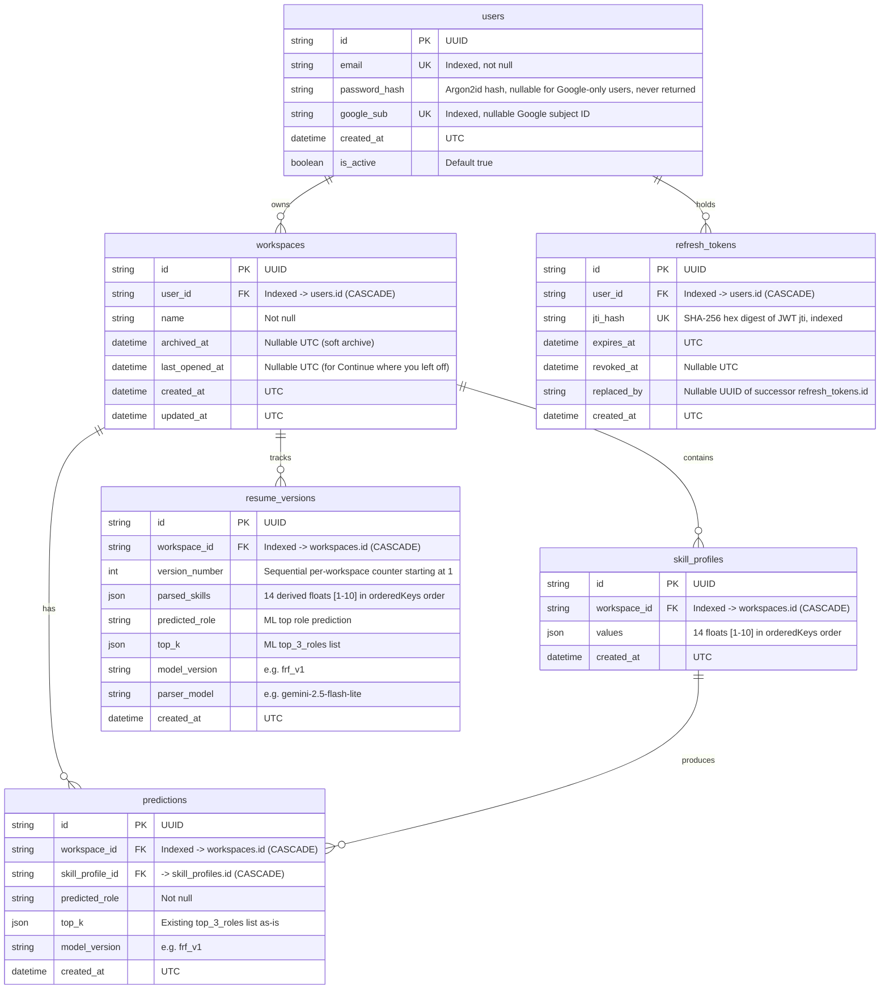

# P1 Design: Accounts and Workspaces (Updated for Part B2 / CP21)

## 1. Overview & Scope
P1 introduces user accounts (email + password and Google Sign-In) and personal workspaces for saving skill profiles, career predictions, and resume-derived score versions, while keeping the existing anonymous `POST /predict` and `POST /parse-resume` endpoints 100% backward compatible.

- **Implemented in P1 Parts A + A2 + B + B2:** Email/password auth, Google ID token login (`POST /auth/google`) & ownership-verified linking (`POST /auth/google/link`), DB-backed atomic refresh token rotation & reuse detection (`refresh_tokens`), per-IP + per-email auth rate limiting, per-IP + per-user resume rate limiting, same-origin Next.js proxy `/api/*` + `SameSite=Lax` cookie + `X-Requested-With` CSRF protection, cross-tab refresh coordination (`Web Locks` + `BroadcastChannel` + `sessionEpoch` + delayed 401 guard), fail-closed startup configuration, workspace archival + `last_opened_at` continuation popup, and CP21 privacy-preserving workspace resume version management (`resume_versions`).
- **Out of scope for P1:** P2 (role-skill gap analysis), M4 (deploy/email approval), and agent/RAG/LLM expansion beyond existing Gemini skill scoring.
- **Unchanged anonymous endpoints:** `POST /predict` and `POST /parse-resume` remain unauthenticated and stateless; no database storage is added to `/parse-resume`.

---

## 2. Data Model (ER Diagram)

### Schema Notes
- **Database Engine:** SQLAlchemy 2.x + Alembic. Configured via `DATABASE_URL` env var, defaulting to `sqlite:///./app.db` (strictly separate from `mlflow.db`). Postgres can replace SQLite via `DATABASE_URL` with no code change.
- **`users.password_hash` & `users.google_sub`:** `password_hash` is nullable to support Google-only accounts; `google_sub` is unique and nullable. Email/password login rejects accounts where `password_hash` is `NULL`.
- **`refresh_tokens`:** Stores SHA-256 hashes of refresh token `jti` values so raw refresh tokens are never persisted in the DB, enabling rotation, logout revocation, and stolen-token reuse detection.
- **`workspaces.archived_at` & `workspaces.last_opened_at`:** `archived_at` supports archive/unarchive filtering; `last_opened_at` updates whenever a workspace is opened (`GET /workspaces/{id}`) and powers `GET /workspaces/last-active`.
- **`skill_profiles.values` & `resume_versions.parsed_skills`:** Store the 14 numeric inputs/scores (`1.0`–`10.0`) in `orderedKeys` order (`computer_architecture` ... `self_transcendence`). `resume_versions` contains **zero** raw resume bytes, filenames, or extracted plaintext.
- **`predictions.top_k` / `resume_versions.top_k`:** Store the existing `top_3_roles` list (`[{"role": str, "probability": float}, ...]`) as-is.
- **Cascading deletes:** Deleting a workspace cascades to its `skill_profiles`, `predictions`, and `resume_versions`. Deleting a user cascades to `workspaces` and `refresh_tokens`.

---

## 3. Authentication, Rotation, & Same-Origin Cookie Design

### Auth Flow (Email/Password & Google Sign-In)
1. **Register (`POST /auth/register`):** Validates email (`email-validator`) and password (min 8 chars), hashes password with **Argon2id** (`argon2-cffi`), creates `users` row, returns `201` with `{id, email, created_at, is_active}` (never `password_hash`).
2. **Login (`POST /auth/login`):** Enforces both per-IP and per-email rate limits. Verifies password against Argon2id hash (rejecting Google-only users cleanly with `401`), then issues:
   - **Access token (JWT, HS256, 15 min TTL):** Returned in JSON response `{access_token, token_type: "bearer"}`. Held **only in frontend React memory** (never `localStorage` or `sessionStorage`).
   - **Refresh token (JWT, HS256, 7 day TTL, unique `jti`):** Persists a `refresh_tokens` row with `jti_hash = sha256(jti)` and sets the JWT in an `HttpOnly` cookie (`refresh_token`).
3. **Google Login (`POST /auth/google`):** Accepts `{id_token}`, verifies signature, issuer, expiry, and audience against `GOOGLE_CLIENT_ID` via `google.oauth2.id_token.verify_oauth2_token`. Refuses unverified emails (`email_verified != true`) and wrong audience (`401`). Finds existing user by `google_sub` or verified `email`.
   - **New user (no existing account):** Creates a row with `password_hash=NULL` and `google_sub` set. Issues token pair.
   - **Existing Google-only account (password_hash already NULL):** Attaches `google_sub` if not already set. Issues token pair.
   - **Existing password account (email matches, password_hash != NULL):** Returns `409 Conflict` — does **NOT** auto-link. Proof of account ownership is required. The 409 detail message tells the client to call `POST /auth/google/link`.
4. **Google Link (`POST /auth/google/link`):** Accepts `{id_token, password}`. Verifies the Google ID token and the account password together. If both are valid: sets `google_sub`, clears `password_hash = NULL` (Google becomes the sole credential), revokes all existing refresh tokens for the user, and issues a fresh token pair. Returns `401` if either credential is wrong. This two-step design ensures no attacker can hijack a password account merely by controlling a Google account with the same email.
5. **Refresh (`POST /auth/refresh`):** Requires `X-Requested-With` header (`403` if missing) and `refresh_token` cookie:
   - Verifies JWT signature, expiry, `type="refresh"`, and `jti`.
   - **Database-level atomicity:** Acquires a write lock upfront (`BEGIN IMMEDIATE` on SQLite when not already in a transaction; `SELECT ... FOR UPDATE` on PostgreSQL and other row-locking engines), then performs a conditional atomic `UPDATE refresh_tokens SET revoked_at = :now WHERE jti_hash = :h AND revoked_at IS NULL` and checks `rowcount`. Concurrent rotations on the same token serialize cleanly: only the first caller succeeds (`200`), while subsequent/racing callers see `revoked_at` already set / `rowcount == 0`.
   - **Reuse detection:** If `revoked_at` is already set (or conditional `UPDATE` returns `rowcount == 0`), revokes **all** non-revoked refresh tokens for that `user_id` and returns `401`.
   - **Rotation:** Inserts a new `refresh_tokens` row with a fresh `jti`, links `replaced_by = new_token.id`, commits atomically, sets the rotated `HttpOnly` cookie, and returns a new `{access_token, token_type: "bearer"}`.
6. **Logout (`POST /auth/logout`):** Requires `X-Requested-With` header (`403` if missing). If a `refresh_token` cookie is present, revokes its matching `refresh_tokens` row (`revoked_at = now`) and clears the cookie.
7. **Current User (`GET /auth/me`):** Requires `Authorization: Bearer <access_token>`, returns `{id, email, created_at, is_active}`.

### JWT Secret & Fail-Closed Startup
- **No hardcoded fallback secret:** The static dev secret has been removed.
- **Non-production:** When `ENVIRONMENT` is explicitly local/dev/test (`!= "production"`) and `DATABASE_URL` is SQLite, if `JWT_SECRET` is unset, a random ephemeral per-process secret is generated via `secrets.token_urlsafe(32)` and a warning is logged. Tokens do not survive process restarts in dev unless `JWT_SECRET` is set.
- **Production fail-closed:** Startup raises `RuntimeError` if `JWT_SECRET` is unset/empty whenever:
  1. `ENVIRONMENT=production`, **OR**
  2. `ENVIRONMENT` is unset/empty **and** `DATABASE_URL` is non-SQLite (e.g. Postgres in a hosted deployment).

### Cookie & CSRF Design (Same-Origin Next.js Proxy)
- **Production plan (Same-Origin Proxy):** Next.js rewrites `/api/*` to the backend origin, making the `refresh_token` cookie first-party on the frontend domain (`vercel.app` or custom domain).
- **Cookie flags:**
  - `HttpOnly=True`, `Path="/"` (so `/api/auth/*` through the Next.js proxy and direct `/auth/*` both receive it).
  - `SameSite="lax"` by default (first-party cookie — avoids Safari/browser third-party `SameSite=None` cookie blocking).
  - `Secure=True` in production (or when `COOKIE_SECURE=true`); `False` in local HTTP dev.
  - **Fallback (`COOKIE_SAMESITE_NONE=true`):** Kept strictly behind an explicit env var fallback (`SameSite="none"`, `Secure=True`) for cross-origin deployments without a proxy.
- **CSRF defense-in-depth:** State-changing cookie endpoints (`POST /auth/refresh`, `POST /auth/logout`) require a custom header `X-Requested-With` (returns `403 Forbidden` if missing), which simple HTML form submissions cannot send and cross-origin requests cannot attach without CORS preflight approval.
- **CORS:** `CORS_ALLOWED_ORIGINS` (comma-separated, default `http://localhost:3000`) with `allow_credentials=True`.

---

## 4. API Endpoints

| Method | Path | Auth / Protection | Request | Response / Behavior |
|---|---|---|---|---|
| `POST` | `/auth/register` | Public (per-IP limit) | `{email, password}` | `201` user profile; `409` if email exists |
| `POST` | `/auth/login` | Public (per-IP + per-email limit) | `{email, password}` | `200` `{access_token, token_type}` + `HttpOnly` refresh cookie |
| `POST` | `/auth/google` | Public (per-IP limit) | `{id_token}` | `200` `{access_token, token_type}` + `HttpOnly` refresh cookie; `409` if email belongs to an unlinked password account |
| `POST` | `/auth/google/link` | Public (per-IP limit) | `{id_token, password}` | `200` `{access_token, token_type}` + cookie (proves password ownership, clears `password_hash`, revokes old tokens); `401` on bad password/token |
| `POST` | `/auth/refresh` | Cookie + `X-Requested-With` | — | `200` `{access_token, token_type}` + rotated cookie; `401` on reuse/expired; `403` without header |
| `POST` | `/auth/logout` | `X-Requested-With` (+ cookie) | — | `200` `{detail: "Logged out"}`, revokes DB token + clears cookie |
| `GET` | `/auth/me` | Bearer access token | — | `200` `{id, email, created_at, is_active}` |
| `POST` | `/workspaces` | Bearer access token | `{name}` | `201` workspace |
| `GET` | `/workspaces` | Bearer access token | `?include_archived=false` | `200` caller's workspaces (non-archived by default) |
| `GET` | `/workspaces/last-active` | Bearer access token | — | `200` most recent non-archived workspace by `last_opened_at`; `404` if none |
| `GET` | `/workspaces/{id}` | Bearer access token | — | `200` workspace (updates `last_opened_at`); `404` if missing or not owner |
| `POST` | `/workspaces/{id}/archive` | Bearer access token | — | `200` workspace (`archived_at` set); `404` if not owner |
| `POST` | `/workspaces/{id}/unarchive` | Bearer access token | — | `200` workspace (`archived_at` cleared); `404` if not owner |
| `DELETE` | `/workspaces/{id}` | Bearer access token | — | `204` (cascades); `404` if missing or not owner |
| `POST` | `/workspaces/{id}/predict` | Bearer access token | `{values: [14 floats]}` | `200` `{predicted_role, top_3_roles, prediction_id, skill_profile_id, model_version, created_at}` |
| `GET` | `/workspaces/{id}/history` | Bearer access token | — | `200` list of predictions + `values` ordered newest first; `404` if not owner |
| `POST` | `/workspaces/{id}/resume-versions` | Bearer + per-IP/user rate limit + consent | Multipart PDF/DOCX + `consent=true` | `201` `ResumeVersionResponse`; `422` if consent false; `413`/`415` validation; `409` when `>= 10` versions; `429` rate limit; `404` if not owner |
| `GET` | `/workspaces/{id}/resume-versions` | Bearer access token | — | `200` list of `ResumeVersionResponse` newest first; `404` if not owner |
| `DELETE` | `/workspaces/{id}/resume-versions/{version_id}` | Bearer access token | — | `204` removes one version; `404` if workspace or version not owned |
| `DELETE` | `/workspaces/{id}/resume-versions` | Bearer access token | — | `204` clears all resume versions for workspace; `404` if not owner |
| `POST` | `/predict` | Public (unchanged) | `{values: [14 floats]}` | `200` `{predicted_role, top_3_roles}` (anonymous, no DB write) |
| `POST` | `/parse-resume` | Public + per-IP rate limit | Multipart PDF/DOCX | `200` `ParsedResumeResponse` (`429` over `20 req/60s`; no DB write) |

---

## 5. Security & Operational Decisions
- **404 instead of 403 on unauthorized workspace access:** All workspace queries filter by `(Workspace.id == workspace_id, Workspace.user_id == current_user.id)`. Missing or other-user workspaces return `404 Not Found` to avoid leaking existence.
- **No secrets or hashes in responses/logs:** Pydantic response schemas exclude `password_hash` and `google_sub` internals; auth errors return generic messages (`"Invalid email or password"`).
- **Rate limiting & Reverse Proxy (`--proxy-headers`):**
  - `infra/docker/Dockerfile.backend` runs `uvicorn` with `--proxy-headers --forwarded-allow-ips "${FORWARDED_ALLOW_IPS:-127.0.0.1}"` so Starlette resolves real client IPs behind trusted proxies (such as Render) instead of sharing one proxy IP bucket across all users.
  - `/auth/login` applies **both** a per-IP rate limit and a per-normalized-email rate limit (`429 Too Many Requests`).
  - `/auth/register`, `/auth/google`, and `/auth/google/link` apply per-IP rate limiting.
  - `/parse-resume` applies per-IP rate limiting (`resume_rate_limiter`: `20 req/60s`) and `/workspaces/{id}/resume-versions` applies **both** per-IP and per-user rate limiting (`20 req/60s`) **before** any DB capacity lookup or Gemini call.
  - *Multi-instance note:* An in-memory limiter is single-process only; Redis-backed rate limiting will be needed before running multiple backend replicas.
- **Cross-Tab Session Hardening (`my-app/lib/apiClient.mjs`):**
  - Refresh calls serialize across tabs via Web Locks (`navigator.locks`) and sync rotated in-memory tokens and `LOGOUT` events over `BroadcastChannel` (never `localStorage`/`sessionStorage`).
  - Monotonic `sessionEpoch` invalidates any in-flight `/auth/refresh` response that finishes after `logout()` runs.
  - Delayed `401` guard skips issuing a duplicate `/auth/refresh` if `accessToken` has already rotated since the failed request was sent.

---

## 6. Resume Versions & Data Retention (CP21 — Implemented in Part B2)
> **Status:** Implemented in Part B2 (Alembic migration `7e7a0f2e3301_part_b2_resume_versions.py`, `WorkspaceResumeVersions.jsx`, `docs/p1/browser-verification-b2.md`).

### Privacy Boundaries & Enforced Rules
1. **Zero raw resume storage:** Neither uploaded PDF/DOCX bytes, filenames, nor extracted resume plaintext are stored in SQL or object storage. Validation (`MAX_RESUME_BYTES` = 5 MB, `.pdf`/`.docx` extension & MIME) runs in memory (`app/services/resume_parser.py`).
2. **Derived outputs only (`resume_versions`):** Each row stores only `id`, `workspace_id`, sequential `version_number` (`max(version_number) + 1` monotonically per workspace), `parsed_skills` (14 numeric `[1-10]` scores), `predicted_role`, `top_k`, `model_version`, `parser_model`, and `created_at`.
3. **Explicit consent gate:** `POST /workspaces/{id}/resume-versions` requires `consent=true` form input (returns `422` otherwise) before calling Gemini; the UI disables `Save Resume Version` until the consent checkbox is checked.
4. **Per-workspace upload cap:** `MAX_RESUME_VERSIONS_PER_WORKSPACE = 10`. Attempting an 11th upload returns `409 Conflict` **without** invoking Gemini, prompting the user to delete existing versions first.
5. **User deletion controls:**
   - **Per-version delete:** `DELETE /workspaces/{id}/resume-versions/{version_id}` removes a single version (`204`, `404` on cross-user access).
   - **Workspace delete-all:** `DELETE /workspaces/{id}/resume-versions` clears all versions for a workspace (`204`), and deleting a workspace cascades to all its `resume_versions`.
