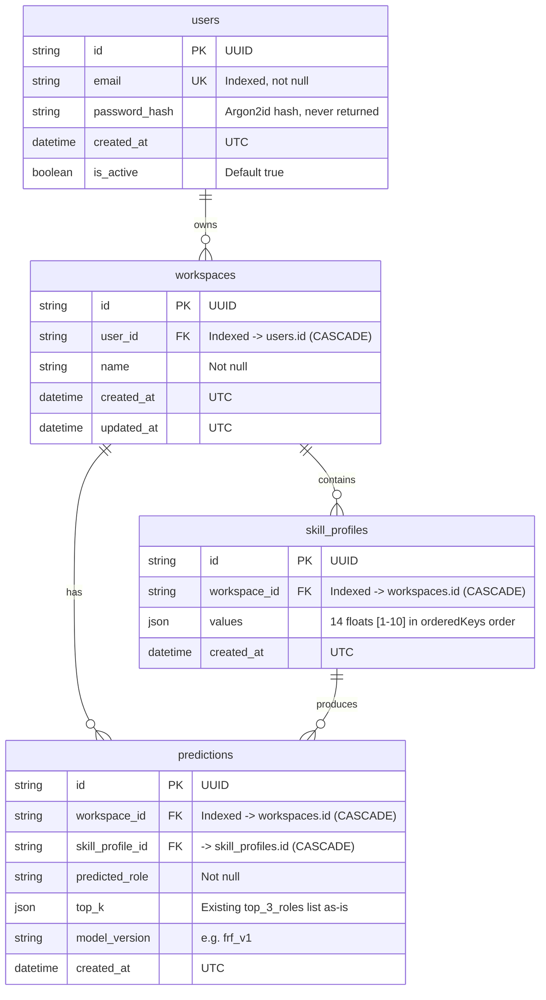

# P1 Design: Accounts and Workspaces

## 1. Overview & Scope
P1 introduces user accounts (email + password) and personal workspaces for saving skill profiles and career predictions, while keeping the existing anonymous `POST /predict` and `POST /parse-resume` endpoints 100% backward compatible.

- **Out of scope for P1:** P2 (role-skill gap analysis), M4 (deploy/email approval), resume storage, Google OAuth (tracked separately in CP19), and agent/RAG/LLM work.
- **Unchanged endpoints:** `POST /predict` and `POST /parse-resume` remain unauthenticated and stateless; no storage is added to `/parse-resume`.

---

## 2. Data Model (ER Diagram)

### Schema Notes
- **Database Engine:** SQLAlchemy 2.x + Alembic. Configured via `DATABASE_URL` env var, defaulting to `sqlite:///./app.db` (strictly separate from `mlflow.db`). Postgres can replace SQLite via `DATABASE_URL` with no code change.
- **`skill_profiles.values`:** Stores the 14 raw UI inputs (`1.0`–`10.0`) in `orderedKeys` order (`computer_architecture` ... `self_transcendence`).
- **`predictions.top_k`:** Stores the existing `top_3_roles` list (`[{"role": str, "probability": float}, ...]`) as-is.
- **Cascading deletes:** Deleting a workspace cascades to its `skill_profiles` and `predictions`.

---

## 3. Authentication & Cross-Origin Token Handling

### Auth Flow
1. **Register (`POST /auth/register`):** Validates email (`email-validator`) and password (min 8 chars), hashes password with **Argon2id** (`argon2-cffi`), creates `users` row, returns `201` with `{id, email, created_at, is_active}` (never `password_hash`).
2. **Login (`POST /auth/login`):** Verifies password against Argon2id hash, issues:
   - **Access token (JWT, HS256, 15 min TTL):** Returned in JSON response `{access_token, token_type: "bearer"}`. Kept **only in frontend React memory** (never `localStorage` or `sessionStorage`).
   - **Refresh token (JWT, HS256, 7 day TTL):** Set as an `HttpOnly` cookie (`refresh_token`).
3. **Refresh (`POST /auth/refresh`):** Reads `refresh_token` from the `HttpOnly` cookie, validates signature/type/expiry and active user status, and returns a fresh `{access_token, token_type: "bearer"}`.
4. **Logout (`POST /auth/logout`):** Clears the `refresh_token` cookie.
5. **Current User (`GET /auth/me`):** Requires `Authorization: Bearer <access_token>`, returns `{id, email, created_at, is_active}`.

### Cross-Origin Refresh Token Decision (Vercel Frontend + Separate Backend)
In production, the Next.js frontend is hosted on Vercel (`https://*.vercel.app`) and the FastAPI backend is hosted on a separate origin (e.g., Render).

- **CORS:** Allowed origins are configured via `CORS_ALLOWED_ORIGINS` (comma-separated list, defaulting to `http://localhost:3000` in dev) with `allow_credentials=True`.
- **Cookie Flags:**
  - **Production (`ENVIRONMENT=production`):** `HttpOnly=True`, `Secure=True`, `SameSite="none"` (required for cross-origin `fetch(..., { credentials: "include" })`), `Path="/auth"`.
  - **Local Dev (`ENVIRONMENT!=production`):** `HttpOnly=True`, `Secure=False`, `SameSite="lax"`, `Path="/auth"`.
- **Tradeoff vs. Keeping Tokens in Memory Only:**
  - *Chosen approach (`HttpOnly` cookie for refresh + memory for access):* Survives browser page reloads without exposing the long-lived refresh credential to JavaScript/XSS. The `SameSite=None` cross-origin requirement introduces CSRF surface on `/auth/refresh`, which is mitigated by strict `CORS_ALLOWED_ORIGINS` (no wildcard `*` with credentials), `Path="/auth"` scoping, and `POST`-only refresh.
  - *Alternative (both tokens in JS memory):* Zero CSRF surface, but forces the user to re-authenticate on every page refresh or tab reopen, degrading UX for workspace continuity.

---

## 4. API Endpoints

| Method | Path | Auth | Request | Response / Behavior |
|---|---|---|---|---|
| `POST` | `/auth/register` | Public (rate-limited) | `{email, password}` | `201` user profile; `409` if email exists |
| `POST` | `/auth/login` | Public (rate-limited) | `{email, password}` | `200` `{access_token, token_type}` + `HttpOnly` cookie; `401` on bad creds |
| `POST` | `/auth/refresh` | Cookie (`refresh_token`) | — | `200` `{access_token, token_type}`; `401` if missing/invalid/expired |
| `POST` | `/auth/logout` | Public | — | `200` `{detail: "Logged out"}` + clears cookie |
| `GET` | `/auth/me` | Bearer access token | — | `200` `{id, email, created_at, is_active}` |
| `POST` | `/workspaces` | Bearer access token | `{name}` | `201` workspace |
| `GET` | `/workspaces` | Bearer access token | — | `200` list of caller's workspaces |
| `GET` | `/workspaces/{id}` | Bearer access token | — | `200` workspace; `404` if missing or owned by another user |
| `DELETE` | `/workspaces/{id}` | Bearer access token | — | `204` (cascades); `404` if missing or owned by another user |
| `POST` | `/workspaces/{id}/predict` | Bearer access token | `{values: [14 floats]}` | `200` `{predicted_role, top_3_roles, prediction_id, skill_profile_id, model_version, created_at}` |
| `GET` | `/workspaces/{id}/history` | Bearer access token | — | `200` list of predictions + `values` ordered newest first; `404` if not owner |
| `POST` | `/predict` | Public (unchanged) | `{values: [14 floats]}` | `200` `{predicted_role, top_3_roles}` (anonymous, no DB write) |
| `POST` | `/parse-resume` | Public (unchanged) | Multipart PDF/DOCX | `200` `ParsedResumeResponse` (no DB write) |

---

## 5. Security & Operational Decisions
- **404 instead of 403 on unauthorized workspace access:** All workspace queries filter by `(Workspace.id == workspace_id, Workspace.user_id == current_user.id)`. Missing or other-user workspaces return `404 Not Found` to avoid leaking existence.
- **Production `JWT_SECRET` guard:** When `ENVIRONMENT=production`, the app refuses to start (`RuntimeError`) if `JWT_SECRET` is unset or blank. Non-production environments fall back to a dev-only secret with a warning log.
- **No secrets or hashes in responses/logs:** Pydantic response schemas exclude `password_hash`; auth errors return generic messages (`"Invalid email or password"`).
- **Rate limiting:**
  - `/auth/login` and `/auth/register` are protected by a simple in-memory per-IP sliding-window rate limiter (`429 Too Many Requests`).
  - *Multi-instance note:* An in-memory limiter is single-process only; Redis-backed rate limiting will be needed before running multiple backend replicas.
  - *Follow-up on `/parse-resume`:* `POST /parse-resume` currently has **no rate limit**. Adding rate limiting to `/parse-resume` (to protect Gemini API quota) is tracked as a follow-up.
