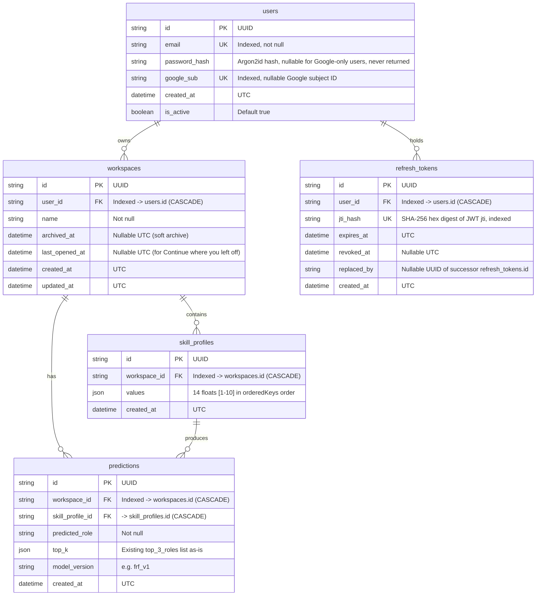

# P1 Design: Accounts and Workspaces (Updated for Part A2)

## 1. Overview & Scope
P1 introduces user accounts (email + password and Google Sign-In) and personal workspaces for saving skill profiles and career predictions, while keeping the existing anonymous `POST /predict` and `POST /parse-resume` endpoints 100% backward compatible.

- **Implemented in P1 Part A + A2:** Email/password auth, Google ID token login (`POST /auth/google`), DB-backed refresh token rotation & reuse detection (`refresh_tokens`), per-IP + per-email rate limiting, same-origin proxy cookie + `X-Requested-With` CSRF protection, fail-closed startup configuration, and workspace archival + `last_opened_at` tracking.
- **Proposed (not implemented in A2):** Resume versions (CP21) — documented in Section 6 below.
- **Out of scope for P1:** P2 (role-skill gap analysis), M4 (deploy/email approval), and agent/RAG/LLM work.
- **Unchanged endpoints:** `POST /predict` and `POST /parse-resume` remain unauthenticated and stateless; no storage is added to `/parse-resume`.

---

## 2. Data Model (ER Diagram)

### Schema Notes
- **Database Engine:** SQLAlchemy 2.x + Alembic. Configured via `DATABASE_URL` env var, defaulting to `sqlite:///./app.db` (strictly separate from `mlflow.db`). Postgres can replace SQLite via `DATABASE_URL` with no code change.
- **`users.password_hash` & `users.google_sub`:** `password_hash` is nullable to support Google-only accounts; `google_sub` is unique and nullable. Email/password login rejects accounts where `password_hash` is `NULL`.
- **`refresh_tokens`:** Stores SHA-256 hashes of refresh token `jti` values so raw refresh tokens are never persisted in the DB, enabling rotation, logout revocation, and stolen-token reuse detection.
- **`workspaces.archived_at` & `workspaces.last_opened_at`:** `archived_at` supports archive/unarchive filtering; `last_opened_at` updates whenever a workspace is opened (`GET /workspaces/{id}`) and powers `GET /workspaces/last-active`.
- **`skill_profiles.values`:** Stores the 14 raw UI inputs (`1.0`–`10.0`) in `orderedKeys` order (`computer_architecture` ... `self_transcendence`).
- **`predictions.top_k`:** Stores the existing `top_3_roles` list (`[{"role": str, "probability": float}, ...]`) as-is.
- **Cascading deletes:** Deleting a workspace cascades to its `skill_profiles` and `predictions`. Deleting a user cascades to `workspaces` and `refresh_tokens`.

---

## 3. Authentication, Rotation, & Same-Origin Cookie Design

### Auth Flow (Email/Password & Google Sign-In)
1. **Register (`POST /auth/register`):** Validates email (`email-validator`) and password (min 8 chars), hashes password with **Argon2id** (`argon2-cffi`), creates `users` row, returns `201` with `{id, email, created_at, is_active}` (never `password_hash`).
2. **Login (`POST /auth/login`):** Enforces both per-IP and per-email rate limits. Verifies password against Argon2id hash (rejecting Google-only users cleanly with `401`), then issues:
   - **Access token (JWT, HS256, 15 min TTL):** Returned in JSON response `{access_token, token_type: "bearer"}`. Held **only in frontend React memory** (never `localStorage` or `sessionStorage`).
   - **Refresh token (JWT, HS256, 7 day TTL, unique `jti`):** Persists a `refresh_tokens` row with `jti_hash = sha256(jti)` and sets the JWT in an `HttpOnly` cookie (`refresh_token`).
3. **Google Login (`POST /auth/google`):** Accepts `{id_token}`, verifies signature, issuer, expiry, and audience against `GOOGLE_CLIENT_ID` via `google.oauth2.id_token.verify_oauth2_token`. Refuses unverified emails (`email_verified != true`) and wrong audience (`401`). Finds existing user by `google_sub` or verified `email`. When linking to an existing email/password account that has a `password_hash`, it clears `password_hash = NULL` (disabling password login in favor of verified Google identity) and revokes all existing `refresh_tokens` for that user; otherwise creates a new user with `password_hash=None` and `google_sub`. Issues access token + rotated refresh cookie.
4. **Refresh (`POST /auth/refresh`):** Requires `X-Requested-With` header (`403` if missing) and `refresh_token` cookie:
   - Verifies JWT signature, expiry, `type="refresh"`, and `jti`.
   - Looks up `jti_hash` in `refresh_tokens`.
   - **Reuse detection:** If `revoked_at` is already set, revokes **all** non-revoked refresh tokens for that `user_id` and returns `401`.
   - **Rotation:** Marks the current `refresh_tokens` row `revoked_at = now`, inserts a new `refresh_tokens` row with a fresh `jti`, sets `replaced_by = new_token.id`, sets the rotated `HttpOnly` cookie, and returns a new `{access_token, token_type: "bearer"}`.
5. **Logout (`POST /auth/logout`):** Requires `X-Requested-With` header (`403` if missing). If a `refresh_token` cookie is present, revokes its matching `refresh_tokens` row (`revoked_at = now`) and clears the cookie.
6. **Current User (`GET /auth/me`):** Requires `Authorization: Bearer <access_token>`, returns `{id, email, created_at, is_active}`.

### JWT Secret & Fail-Closed Startup
- **No hardcoded fallback secret:** The static dev secret has been removed.
- **Non-production:** When `ENVIRONMENT` is explicitly local/dev/test (`!= "production"`) and `DATABASE_URL` is SQLite, if `JWT_SECRET` is unset, a random ephemeral per-process secret is generated via `secrets.token_urlsafe(32)` and a warning is logged. Tokens do not survive process restarts in dev unless `JWT_SECRET` is set.
- **Production fail-closed:** Startup raises `RuntimeError` if `JWT_SECRET` is unset/empty whenever:
  1. `ENVIRONMENT=production`, **OR**
  2. `ENVIRONMENT` is unset/empty **and** `DATABASE_URL` is non-SQLite (e.g. Postgres in a hosted deployment).

### Cookie & CSRF Design (Same-Origin Next.js Proxy)
- **Production plan (Same-Origin Proxy):** Next.js rewrites `/api/*` to the backend origin, making the `refresh_token` cookie first-party on the frontend domain (`vercel.app` or custom domain).
- **Cookie flags:**
  - `HttpOnly=True`, `Path="/"` (so `/api/auth/*` through the Next.js proxy and direct `/auth/*` both receive it).
  - `SameSite="lax"` by default (first-party cookie — avoids Safari/browser third-party `SameSite=None` cookie blocking).
  - `Secure=True` in production (or when `COOKIE_SECURE=true`); `False` in local HTTP dev.
  - **Fallback (`COOKIE_SAMESITE_NONE=true`):** Kept strictly behind an explicit env var fallback (`SameSite="none"`, `Secure=True`) for cross-origin deployments without a proxy.
- **CSRF defense-in-depth:** State-changing cookie endpoints (`POST /auth/refresh`, `POST /auth/logout`) require a custom header `X-Requested-With` (returns `403 Forbidden` if missing), which simple HTML form submissions cannot send and cross-origin requests cannot attach without CORS preflight approval.
- **CORS:** `CORS_ALLOWED_ORIGINS` (comma-separated, default `http://localhost:3000`) with `allow_credentials=True`.

---

## 4. API Endpoints

| Method | Path | Auth / Protection | Request | Response / Behavior |
|---|---|---|---|---|
| `POST` | `/auth/register` | Public (per-IP limit) | `{email, password}` | `201` user profile; `409` if email exists |
| `POST` | `/auth/login` | Public (per-IP + per-email limit) | `{email, password}` | `200` `{access_token, token_type}` + `HttpOnly` refresh cookie |
| `POST` | `/auth/google` | Public (per-IP limit) | `{id_token}` | `200` `{access_token, token_type}` + `HttpOnly` refresh cookie |
| `POST` | `/auth/refresh` | Cookie + `X-Requested-With` | — | `200` `{access_token, token_type}` + rotated cookie; `401` on reuse/expired; `403` without header |
| `POST` | `/auth/logout` | `X-Requested-With` (+ cookie) | — | `200` `{detail: "Logged out"}`, revokes DB token + clears cookie |
| `GET` | `/auth/me` | Bearer access token | — | `200` `{id, email, created_at, is_active}` |
| `POST` | `/workspaces` | Bearer access token | `{name}` | `201` workspace |
| `GET` | `/workspaces` | Bearer access token | `?include_archived=false` | `200` caller's workspaces (non-archived by default) |
| `GET` | `/workspaces/last-active` | Bearer access token | — | `200` most recent non-archived workspace by `last_opened_at`; `404` if none |
| `GET` | `/workspaces/{id}` | Bearer access token | — | `200` workspace (updates `last_opened_at`); `404` if missing or not owner |
| `POST` | `/workspaces/{id}/archive` | Bearer access token | — | `200` workspace (`archived_at` set); `404` if not owner |
| `POST` | `/workspaces/{id}/unarchive` | Bearer access token | — | `200` workspace (`archived_at` cleared); `404` if not owner |
| `DELETE` | `/workspaces/{id}` | Bearer access token | — | `204` (cascades); `404` if missing or not owner |
| `POST` | `/workspaces/{id}/predict` | Bearer access token | `{values: [14 floats]}` | `200` `{predicted_role, top_3_roles, prediction_id, skill_profile_id, model_version, created_at}` |
| `GET` | `/workspaces/{id}/history` | Bearer access token | — | `200` list of predictions + `values` ordered newest first; `404` if not owner |
| `POST` | `/predict` | Public (unchanged) | `{values: [14 floats]}` | `200` `{predicted_role, top_3_roles}` (anonymous, no DB write) |
| `POST` | `/parse-resume` | Public (unchanged) | Multipart PDF/DOCX | `200` `ParsedResumeResponse` (no DB write) |

---

## 5. Security & Operational Decisions
- **404 instead of 403 on unauthorized workspace access:** All workspace queries filter by `(Workspace.id == workspace_id, Workspace.user_id == current_user.id)`. Missing or other-user workspaces return `404 Not Found` to avoid leaking existence.
- **No secrets or hashes in responses/logs:** Pydantic response schemas exclude `password_hash` and `google_sub` internals; auth errors return generic messages (`"Invalid email or password"`).
- **Rate limiting & Reverse Proxy (`--proxy-headers`):**
  - `infra/docker/Dockerfile.backend` runs `uvicorn` with `--proxy-headers --forwarded-allow-ips "${FORWARDED_ALLOW_IPS:-127.0.0.1}"` so Starlette resolves real client IPs behind trusted proxies (such as Render) instead of sharing one proxy IP bucket across all users.
  - `/auth/login` applies **both** a per-IP rate limit and a per-normalized-email rate limit (`429 Too Many Requests`).
  - `/auth/register` and `/auth/google` apply per-IP rate limiting.
  - *Multi-instance note:* An in-memory limiter is single-process only; Redis-backed rate limiting will be needed before running multiple backend replicas.
  - *Follow-up on `/parse-resume`:* `POST /parse-resume` currently has **no rate limit**. Adding rate limiting to `/parse-resume` (to protect Gemini API quota) is tracked as a follow-up.

---

## 6. Proposed: Resume Versions & Data Retention (CP21 — Not Implemented in A2)
> **Status:** Proposed design only; NOT coded in Part A2. Will be implemented in its own follow-up part after the frontend (Part B).

### Design Goals & Privacy Boundaries
Resumes contain PII, and free-tier LLM APIs (such as Gemini free tier) may retain or train on submitted prompts unless opted out. To minimize privacy exposure:
1. **Do NOT store raw files or raw resume text:** Neither the uploaded PDF/DOCX bytes nor extracted plaintext will be saved in the database or object storage.
2. **Store derived outputs only:** Each resume version record (`resume_versions`) stores only:
   - `id`, `workspace_id`, `version_number` (or label), `created_at`
   - `parsed_skills` (the 14 numeric `[1-10]` scores produced by the parser)
   - `model_output` (`predicted_role`, `top_k`, `model_version`) — i.e., the ML model reading alongside the LLM-parsed skill vector
   - Non-sensitive summary flags (e.g., parser model identifier)
3. **Logging rule:** Application logs **must never** contain raw resume text, extracted snippets, file bytes, or user PII filenames. Log only request status, byte count, and timing.
4. **User deletion controls:**
   - **Per-version delete (proposed):** `DELETE /workspaces/{id}/resume-versions/{version_id}` removes a single version.
   - **Delete-all endpoint (proposed):** `DELETE /auth/me/resume-data` (and/or `DELETE /workspaces/{id}/resume-versions`) deletes all stored resume-derived versions for the authenticated user (or workspace).
5. **Retention limit:**
   - Cap stored versions per workspace (e.g., max `10` resume versions per workspace; oldest pruned on insert or rejected with prompt to delete) and/or time-based retention (e.g., auto-expire after `90` days).

### Open Questions (To Decide Before Coding CP21)
1. **Gemini API tier / prompt retention:** Should we require a paid Gemini API key (zero-data-retention terms) in production or display an explicit consent notice before sending resume text to `/parse-resume`?
2. **Retention policy exact numbers:** Should the cap be per-workspace (`N = 10` versions), per-user, or time-based (`90 days`), and should overflow auto-prune the oldest version or return `409 Conflict`?
3. **Cascade on "delete my resume data":** Should `DELETE /auth/me/resume-data` delete only `resume_versions`, or also any `skill_profiles` and `predictions` rows that originated from a resume upload?
4. **Workspace linkage:** Should uploading a resume in a workspace automatically create a `skill_profile` + `prediction` entry in `history`, or live in a dedicated `resume_versions` timeline rendered alongside manual predictions?
